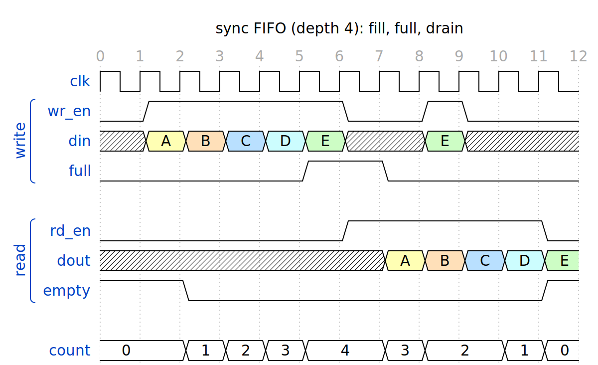

# wavedrom skill for Claude Code

讓 [Claude Code](https://claude.com/claude-code) 在寫或解釋 Verilog/RTL 時序時，主動用 [WaveDrom](https://wavedrom.com/) 畫出波形圖。每張圖會存成白底 PNG，並自動用瀏覽器打開，不再只靠文字描述時序。



## 功能

- 解釋 handshake、FSM、pipeline、FIFO、counter、reset、CDC、testbench 等時序時，Claude 會**主動畫波形**，再依 cycle 編號逐步說明
- 每張圖存在 `~/waveforms/`，包含三個檔：
  - `<name>.png`：白底圖片（可改成 SVG）
  - `<name>.html`：用 WaveDrom 官方 JS 繪製，可下載 SVG/PNG，也有 WaveDrom editor 連結
  - `<name>.json`：原始 WaveJSON，方便修改後重畫
- 檔名有意義，例如 `uart_tx_8n1_send_0xA5`、`sync_fifo_full_write_ignored`；同名時自動加 `_2`、`_3`，不會覆蓋舊圖
- Claude 回覆前會先檢查產生的圖片，確認時序正確

## 需求

- Claude Code
- Python 3
- Linux / WSL / macOS。在 WSL 中會用 Windows 預設瀏覽器打開 HTML
- 網路：只有安裝時需要，以及 HTML 檔要從 CDN 載入 WaveDrom。PNG/SVG 在本機離線產生
- 也能在 Claude Code Desktop 和 claude.ai 使用，波形會直接顯示在對話裡（見下方）

## 安裝

```bash
# 1. 把 skill clone 到 Claude Code 的全域 skills 資料夾
git clone https://github.com/YANG-LI-HENG/wavedrom-skill.git ~/.claude/skills/wavedrom

# 2. 安裝產生圖片用的套件（Python WaveDrom + cairosvg）
#    會建一個 venv 在 ~/.local/share/wavedrom-venv，不需要 sudo
~/.claude/skills/wavedrom/scripts/setup.sh
```

`cairosvg` 需要系統有 cairo 函式庫。大多數 Linux/WSL 預設就有；如果沒有，Ubuntu 可以用 `sudo apt install libcairo2` 安裝，macOS 用 `brew install cairo`。

### 3.（建議）讓 Claude 一律主動畫圖

Claude 會依 skill 的說明自行判斷要不要畫圖。若要更穩定，可以在全域的 `~/.claude/CLAUDE.md`（或 Verilog 專案的 `CLAUDE.md`）加入：

```markdown
# Waveforms

寫或解釋 Verilog/SystemVerilog 時序（handshake、FSM、pipeline、counter、FIFO、reset、CDC、testbench 等）時，一律先用 wavedrom skill 畫波形再說明。
```

裝好後**開一個新的 Claude Code session** 就會生效。

## 使用

- **自動**：直接問時序相關的問題，例如「這個 FIFO full 的時候寫入會怎樣？」，Claude 會先畫圖再解釋
- **手動**：打 `/wavedrom`，或直接說「畫波形」「畫時序圖」
- **不經過 Claude**：自己執行 script

```bash
python3 ~/.claude/skills/wavedrom/scripts/wave2img.py -n demo_handshake -e "{signal:[
  {name:'clk',   wave:'p.....'},
  {name:'valid', wave:'01..0.'},
  {name:'ready', wave:'0.1.0.'},
  {name:'data',  wave:'x34.x.', data:'A B'}
], head:{text:'valid/ready', tick:0}}"
```

WaveJSON 語法請參考 [WaveDrom tutorial](https://wavedrom.com/tutorial.html)。

## 在 Claude Code Desktop / claude.ai 使用

在這兩個環境中，Claude 會把波形畫成 **artifact，直接顯示在對話裡**，不存 PNG，也不開瀏覽器。版面樣式在 `templates/artifact.html`。

- **Claude Code Desktop**：安裝方式和上面相同（clone 到 `~/.claude/skills/wavedrom`）。Claude 會依環境變數 `CLAUDE_CODE_ENTRYPOINT` 自動判斷目前在 Desktop，用 Artifact 工具顯示波形。
- **claude.ai**：claude.ai 讀不到本機的檔案，所以要上傳一次 skill：
  1. 把這個資料夾打包成 zip（不需要另外安裝 `zip`）：
     ```bash
     cd ~/.claude/skills && python3 -c "import shutil; shutil.make_archive('wavedrom', 'zip', '.', 'wavedrom')"
     ```
     產生的 `~/.claude/skills/wavedrom.zip` 裡會包含 `.git`，不影響使用。
  2. 到 claude.ai 的 **Settings → Capabilities → Skills** 上傳 `wavedrom.zip`（需要先開啟 code execution）
  3. 之後在 claude.ai 問時序問題，Claude 就會直接產生波形 artifact

## 設定

`~/.config/wavedrom-skill/config.json`（檔案不存在時使用下面的預設值；命令列參數優先）：

```json
{ "format": "png", "out": "~/waveforms", "scale": 2, "open": true }
```

| 欄位 | 說明 |
|---|---|
| `format` | `png`（白底，預設）、`svg`、`both`、`none` |
| `out` | 輸出資料夾，不存在時會自動建立 |
| `scale` | PNG 放大倍率 |
| `open` | 畫完是否自動用瀏覽器打開 HTML |

單次覆寫：`-f svg`、`--scale 3`、`--no-open`、`--overwrite`（覆蓋同名檔，不加 `_2`）

## 檔案

| 路徑 | 說明 |
|---|---|
| `SKILL.md` | skill 本體：何時畫、怎麼寫 WaveJSON、如何確保時序和 RTL 一致、檔名規則 |
| `scripts/wave2img.py` | WaveJSON → PNG/SVG + HTML + JSON |
| `scripts/setup.sh` | 安裝 Python WaveDrom + cairosvg |
| `scripts/wave2term.py` | 同樣的 WaveJSON 轉成 terminal 文字波形（備用） |
| `templates/artifact.html` | Desktop / claude.ai 直接顯示用的 artifact 樣板 |
